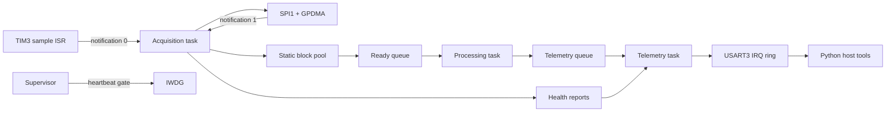

# DRATS — Deterministic Real-Time Acquisition & Telemetry System

[](https://github.com/lee-cheng-han/real-time-embedded-acquisition-platform/actions/workflows/ci.yml)


DRATS is a real-time embedded data-acquisition platform for the STM32H563. It models
the firmware architecture of an industrial sensor hub: a hardware timer establishes
the sampling cadence, SPI/GPDMA acquires six-axis sensor data, statically allocated
FreeRTOS tasks process and frame it, and an interrupt-driven UART transports binary
telemetry to a Python client.

The project also includes health supervision, bounded recovery state machines,
power-loss-aware records, signed firmware packages, and an authenticated Cortex-M boot
path. Hardware-independent behavior is executable on Linux, allowing meaningful tests
and fault injection without a development board.

> **Validation status:** the portable core, protocol, host tools, boot verifier, and
> recovery policies are host-tested. Both target variants and the bootloader
> cross-compile for ARM and pass memory/vector checks. Physical SPI/GPDMA timing,
> watchdog reset behavior, and sustained-load results remain unvalidated until hardware
> is available; this repository does not present simulated measurements as board data.

## Highlights

- **Deterministic ownership:** fixed blocks follow
  `FREE → DMA → READY → PROCESSING → TELEMETRY → FREE`; atomic transitions and
  generation-tagged handles reject stale access.
- **Static FreeRTOS design:** five priority-ordered tasks, static stacks and queues,
  indexed ISR notifications, bounded waits, and no steady-state allocation.
- **Register-level target drivers:** TIM2/TIM3, SPI1, GPDMA, USART3, GPIO, IWDG, reset
  diagnostics, and a real ICM-42688-P backend.
- **Observable failure behavior:** explicit overflow policies, task heartbeats, reset
  reasons, health frames, fault counters, peripheral restart, and sensor re-probe.
- **Binary telemetry:** synchronization, versioning, sequence numbers, monotonic
  timestamps, CRC32C, configuration commands, acknowledgements, and health reports.
- **Authenticated development boot:** SHA-256 and ECDSA-P256 verification through a
  pinned minimal Mbed TLS build, metadata and counter validation, vector checks, and
  MSP/VTOR application handoff.
- **Measurement tooling:** an optional 6,168-byte ISR/task trace records trigger, wake,
  DMA, processing, UART, and recovery events for JSON/CSV percentile analysis.
- **Reproducible evidence:** 12 sanitizer-backed tests plus ARM size, layout, vector,
  signed-package, tampering, and rollback checks.

## System architecture



The DMA ISR publishes completion state and wakes the acquisition task; it does not
process samples. Blocks remain owned by the pool until UART submission succeeds, so
telemetry congestion becomes visible backpressure instead of silent corruption. The
current encoder copies samples once into the UART frame and therefore makes no
zero-copy claim.

## Target and memory layout

The selected platform is the **NUCLEO-H563ZI** with an STM32H563ZIT6 and a 3.3 V
ICM-42688-P SPI breakout.

| Flash region | Address | Size | Purpose |
|---|---:|---:|---|
| Bootloader | `0x08000000` | 128 KiB | Authentication and application handoff |
| Application A | `0x08020000` | 768 KiB | Current firmware image |
| Application B | `0x080E0000` | 768 KiB | Proposed rollback slot |
| Update scratch | `0x081A0000` | 256 KiB | Proposed staging area |
| Metadata | `0x081E0000` | 128 KiB | Signed metadata and persistent records |

The linker scripts enforce the bootloader and application-A regions. Application B,
scratch programming, and protected persistent anti-rollback remain design work rather
than completed production-update claims.

## Build and test

### Host build

Requirements:

- Linux or WSL
- CMake 3.20+
- GCC or Clang with C17 support
- Ninja or Make
- Python 3
- OpenSSL 3.x

```sh
git clone https://github.com/lee-cheng-han/real-time-embedded-acquisition-platform.git
cd real-time-embedded-acquisition-platform
./scripts/test.sh
```

This builds the portable core with strict warnings, AddressSanitizer, and
UndefinedBehaviorSanitizer, then runs CTest. Machine-readable results are written to
`build/host/test-results.xml`.

### Complete host and ARM verification

Install the Arm GNU toolchain so `arm-none-eabi-gcc` is on `PATH`, then run:

```sh
./scripts/check_all.sh
```

The script downloads pinned STM32 CMSIS, device, FreeRTOS, and Mbed TLS sources into
the ignored `build/deps` directory. It then:

1. runs all host tests under sanitizers;
2. builds the simulated-sensor STM32 application;
3. builds the ICM-42688-P, watchdog, and timing-trace variant;
4. builds and validates the authenticated bootloader;
5. generates signed simulator and physical-sensor factory images; and
6. compiles the embedded verifier natively and tests valid, tampered, and rollback
   packages.

Current release-build footprints:

| Artifact | Flash | RAM | Budget |
|---|---:|---:|---:|
| Simulator application | 14,696 B | 18,036 B | 768 KiB flash / 128 KiB RAM |
| Sensor + watchdog + trace | 17,992 B | 24,268 B | 768 KiB flash / 128 KiB RAM |
| Authenticated bootloader | 29,420 B | 1,464 B | 128 KiB flash |

Generated reports under `build/` are authoritative if these figures change.

## Run the simulator and host tools

Generate and inspect a deterministic capture:

```sh
build/host/drats_sim 1000 > build/host/capture.drat
python3 host/cli/drats_cli.py inspect build/host/capture.drat
python3 host/cli/drats_cli.py health build/host/capture.drat
python3 host/cli/drats_cli.py export \
  build/host/capture.drat build/host/capture.csv
python3 host/benchmarks/analyze.py \
  build/host/capture.drat --svg build/host/jitter.svg
```

Configure and capture from a physical device once connected:

```sh
python3 host/cli/drats_cli.py configure /dev/ttyACM0 \
  --rate 1000 --block-size 32 --overflow stop
python3 host/cli/drats_cli.py capture /dev/ttyACM0 \
  build/hardware/capture.drat --baud 2000000 --duration 30
```

Device timestamps are analyzed independently from host time until a clock relationship
has been measured.

## Firmware authentication

Create and verify a standalone signed package:

```sh
openssl genpkey -algorithm EC -pkeyopt ec_paramgen_curve:P-256 -out private.pem
openssl pkey -in private.pem -pubout -out public.pem
python3 host/cli/drats_image.py pack \
  build/target/drats_firmware.bin private.pem build/target/update.drat \
  --version 1 0 0 --security-counter 1
python3 host/cli/drats_image.py verify build/target/update.drat public.pem
```

For factory builds, the scripts generate an ignored workspace-local development key in
`build/keys` and compile only its public point into the bootloader. This key is for
testing. Production deployment requires protected key provisioning, bootloader write
protection, debug/lifecycle policy, and persistent monotonic anti-rollback storage.

## Timing trace

The trace-enabled target exports the symbol `drats_timing_trace`. Halt the target over
SWD, dump the buffer with GDB, and decode it:

```gdb
dump binary memory build/hardware/timing-trace.bin &drats_timing_trace ((char *)&drats_timing_trace + sizeof(drats_timing_trace))
```

```sh
python3 scripts/decode_timing_trace.py build/hardware/timing-trace.bin \
  --output build/hardware/timing-trace.json \
  --csv build/hardware/timing-trace.csv
```

The decoder reports p50, p95, p99, and maximum event intervals and paired latencies.
Hardware claims should also be checked with GPIO instrumentation and a logic analyzer
to quantify trace overhead.

## Verification coverage

| Layer | Evidence |
|---|---|
| Unit | CRC vector, pool/queue boundaries, ownership, configuration, supervisor, image metadata, boot policy, sensor codec, trace wrap |
| Integration | 100,000-sample pipeline, C/Python protocol compatibility, signed-image verification, timing-trace decoding |
| Fault injection | DMA timeout, transfer error, saturation, corrupt packet, stale handle, lost completion, failed revalidation |
| Endurance | Repeated acquisition and recovery with counter and ownership invariants under sanitizers |
| Target | Two ARM application variants plus bootloader; partition, stack pointer, vector, reset-symbol, and size checks |
| Authentication | OpenSSL package tests and the exact Mbed TLS boot verifier reject image/signature tampering and rollback |

Host simulation cannot validate NVIC timing, DMA request routing, electrical behavior,
flash interruption, watchdog resets, or physical handoff. The status ledger keeps these
boundaries explicit.

## Repository layout

```text
bootloader/       authenticated development bootloader and Mbed TLS configuration
common/           portable acquisition, ownership, protocol, recovery, and boot logic
firmware/         STM32 application, FreeRTOS configuration, startup, and drivers
host/             Python protocol, serial transport, CLI, and analysis tools
simulation/       deterministic six-channel acquisition simulator
tests/            unit, integration, fault-injection, and endurance tests
scripts/          dependency, build, packaging, validation, and trace tools
docs/             architecture, protocol, hardware, timing, update, and evidence docs
```

## Documentation

- [Architecture and timing budgets](docs/architecture.md)
- [Current implementation status](docs/status.md)
- [Hardware selection and wiring](docs/hardware.md)
- [Hardware bring-up and evidence runbook](docs/hardware_bringup.md)
- [Driver contracts](docs/drivers.md)
- [Telemetry protocol](docs/protocol.md)
- [Firmware-update design](docs/firmware_update.md)
- [Memory map](docs/memory_map.md)
- [Verification strategy](docs/verification.md)
- [Performance evidence](docs/performance.md)
- [Resume evidence ledger](docs/resume_evidence.md)
- [Resume-ready summary](docs/resume_summary.md)

## Current limitations

- No physical board or sensor validation has been performed.
- The firmware-update state machine and redundant records are host-tested, but target
  flash programming and physical A/B selection are not implemented.
- The development boot key is generated locally and is not a production root of trust.
- Timing and throughput values from simulation are regression evidence, not MCU
  performance results.
- Pin routing, cache/memory visibility, erase geometry, and option-byte policy still
  require confirmation on the exact board revision and target device.

These limitations are intentional claim boundaries. The next milestone is the
reproducible hardware campaign in
[docs/hardware_bringup.md](docs/hardware_bringup.md).
