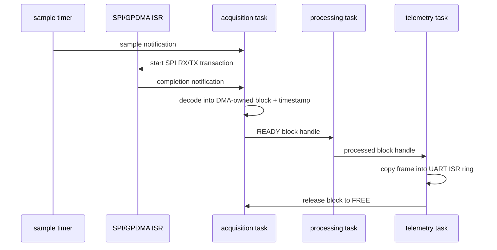
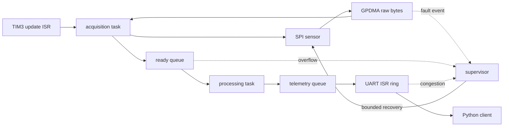

# DRATS architecture and implementation plan

Status: software baseline, 2026-10-10. Hardware results remain explicitly unvalidated.

## Scope and acceptance gates

DRATS is a deterministic sensor acquisition pipeline for the STM32H563ZI. A hardware
timer wakes the acquisition task once per sample period. The task starts a bounded
SPI1 RX/TX GPDMA transaction and copies the decoded six-axis result into its owned
acquisition block. A completed block moves through processing to an interrupt-driven
UART ring. No steady-state allocation is permitted. This path is not described as
zero-copy because sensor decoding and telemetry framing both copy data.

The project advances through evidence gates:

| Gate | Acceptance criterion | Current evidence |
|---|---|---|
| Host core | Strict C17 build; unit, integration, and injected-fault tests pass under ASan/UBSan | Implemented by the host build |
| Target build | `arm-none-eabi-gcc` links application and authenticated development bootloader with reviewed vector and size reports | Implemented for simulated and sensor/watchdog variants plus development bootloader |
| Board bring-up | Clock, GPIO, monotonic timer, UART, SPI and GPDMA smoke tests pass on NUCLEO-H563ZI | Requires hardware |
| Sustained acquisition | No loss at the configured rate for a 12-hour run; loss counters agree with injected gaps | Requires hardware |
| Recovery | Each listed fault reaches a revalidated RUNNING or explicit DEGRADED state within its deadline | Host policy tests partially implemented; hardware injection remains |
| Update safety | Valid signed image boots, invalid image is rejected, reset at every erase/program boundary recovers | Embedded verifier and host boot policy tested; physical boot/flash interruption pending |
| Performance | Reproducible raw data records worst observed and p50/p95/p99 latency and jitter | Requires hardware |

## Execution model

FreeRTOS priorities use a higher number for a higher priority. Exact stack sizes are
set only after high-water measurements.

| Context | Priority | Wake source | Bounded responsibility |
|---|---:|---|---|
| TIM3 ISR | NVIC 6 | 1 kHz update | clear update and notify acquisition on index 0 |
| GPDMA/SPI ISR | NVIC 6 | transfer complete/error | stop transaction, deassert CS, notify acquisition on index 1 |
| acquisition | 5 | indexed task notifications | start SPI transfer, decode sample, fill and publish owned block |
| processing | 4 | ready queue | validate samples and apply bounded transforms |
| telemetry | 3 | processed queue | encode frame in a fixed slot and submit to bounded UART ring |
| supervisor | 2 | periodic timer/fault event | check heartbeats and deadlines; drive recovery state machines |
| diagnostics | 1 | periodic timer | snapshot counters and low-priority persistent logging |
| idle | 0 | scheduler | stack checks and low-power entry |

Priorities preserve the acquisition deadline while keeping recovery and reporting out
of interrupt context. The UART ISR is lower urgency than acquisition DMA. All ISRs
that call FreeRTOS APIs will use an NVIC priority numerically at or below the configured
`configLIBRARY_MAX_SYSCALL_INTERRUPT_PRIORITY`; the actual value is frozen during
Cube integration and checked with `configASSERT`.

## Ownership and backpressure

The fixed block pool has the only payload storage. Legal ownership is:

`FREE -> DMA -> READY -> PROCESSING -> TELEMETRY -> FREE`.

Transitions are compare/exchange operations on host and short interrupt-masked
critical sections on the MCU if the selected compiler's atomics are not lock-free.
Handles contain an index and generation so stale releases are rejected. The DMA ISR
never overwrites a non-FREE block. With no free block, acquisition increments the
overflow counter and follows the configured policy: stop (default, loss-intolerant) or
drop-newest. Telemetry congestion therefore becomes visible backpressure rather than
silent corruption.

The notification carries no payload pointer; block metadata is committed before the
release transition to READY, and the consumer executes an acquire operation when
claiming the block. The current GPDMA transaction targets a task-stack raw-byte buffer;
the acquisition task decodes it into the owned block. H563 DMA memory visibility and
cache behavior still require physical validation.

## Initial requirements and budgets

The hardware backend workload is a 6-axis, signed 16-bit sample at 1 ksample/s, grouped
into 32-sample blocks. That is 12 kB/s raw and about 13.2 kB/s after one 24-byte frame
header, block metadata, CRC, and UART framing. A 2 Mbaud UART (8-N-1, 200 kB/s useful)
leaves substantial margin. The simulator can exercise higher configured rates. These
are design calculations, not measured performance.

The first SRAM budget is 128 KiB maximum: 16 KiB acquisition pool, 24 KiB telemetry
pool, 40 KiB task stacks, 16 KiB RTOS/kernel objects, and 32 KiB margin. Application
flash is budgeted at 768 KiB per slot. A proposed 2 MiB dual-bank layout is documented
in `memory_map.md`; final sector constraints must be checked against RM0481 before use.

Latency requirements are: sampling jitter below 10 us p99, interrupt-to-task latency
below 20 us p99, and acquisition-to-UART-submit below 5 ms p99 at 1 ksample/s.
Recovery deadlines are 10 ms for a transient SPI/DMA restart and 500 ms for sensor
re-probe. These remain targets until physical measurements exist.

## Peripheral allocation

The implemented mapping is TIM3 update ISR -> acquisition task -> SPI1 RX/TX GPDMA,
USART3 for the ST-LINK virtual COM port, TIM2 as a 32-bit monotonic counter extended in software, one
GPIO for data-ready/instrumentation, IWDG for last-resort reset, and internal dual-bank
flash for images/settings. Pin mux, request routing, USART connection, and timer clock
rates must be confirmed in CubeMX, the board schematic, DS14121, and RM0481 before the
target layer is accepted.

## Technical risks

The main risks are UART headroom at higher sample rates, timestamp comparability with
the host, GPDMA request routing details, cache/memory visibility, flash erase effects
on real-time work, and fitting two signed images plus scratch/metadata. Mitigations are
rate negotiation, on-device jitter measurement, GPIO timing probes, explicit memory
placement, updates only in bootloader context, and map-file size gates.
