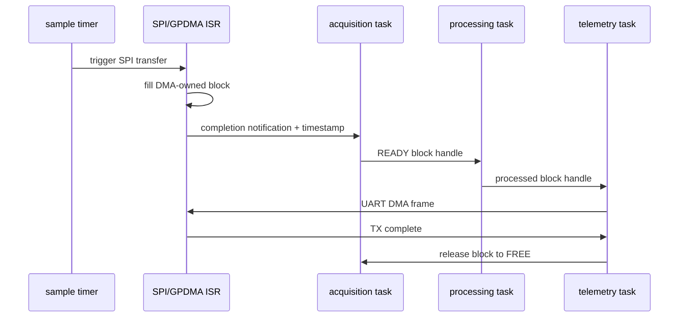
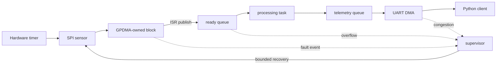

# DRATS architecture and implementation plan

Status: design baseline, 2026-10-09. Statements in this document are requirements or
design decisions unless explicitly marked as validated.

## Scope and acceptance gates

DRATS is a deterministic sensor acquisition pipeline for the STM32H563ZI. A hardware
timer initiates one SPI transaction per sample period. GPDMA moves the SPI words into
a statically allocated acquisition block. The DMA ISR timestamps and publishes a full
block; processing validates and transforms it; telemetry frames it for UART DMA. No
steady-state allocation is permitted.

The project advances through evidence gates:

| Gate | Acceptance criterion | Current evidence |
|---|---|---|
| Host core | Strict C17 build; unit, integration, and injected-fault tests pass under ASan/UBSan | Implemented by the host build |
| Target build | `arm-none-eabi-gcc` links application and bootloader using reviewed linker maps | Blocked until the ARM toolchain/Cube dependencies are installed |
| Board bring-up | Clock, GPIO, monotonic timer, UART, SPI and GPDMA smoke tests pass on NUCLEO-H563ZI | Requires hardware |
| Sustained acquisition | No loss at the configured rate for a 12-hour run; loss counters agree with injected gaps | Requires hardware |
| Recovery | Each listed fault reaches a revalidated RUNNING or explicit DEGRADED state within its deadline | Host policy tests partially implemented; hardware injection remains |
| Update safety | Valid signed image boots, invalid image is rejected, reset at every erase/program boundary recovers | Design only |
| Performance | Reproducible raw data records worst observed and p50/p95/p99 latency and jitter | Requires hardware |

## Execution model

FreeRTOS priorities use a higher number for a higher priority. Exact stack sizes are
set only after high-water measurements.

| Context | Priority | Wake source | Bounded responsibility |
|---|---:|---|---|
| GPDMA/SPI ISR | NVIC 6 | transfer complete/error | timestamp, transition ownership, notify acquisition; no parsing or logging |
| acquisition | 5 | direct task notification | validate completion, arm the next free block, publish ready block |
| processing | 4 | ready queue | validate samples and apply bounded transforms |
| telemetry | 3 | processed queue/UART completion | encode frame in a fixed TX slot and submit UART DMA |
| supervisor | 2 | periodic timer/fault event | check heartbeats and deadlines; drive recovery state machines |
| diagnostics | 1 | periodic timer | snapshot counters and low-priority persistent logging |
| idle | 0 | scheduler | stack checks and low-power entry |

Priorities preserve the acquisition deadline while keeping recovery and reporting out
of interrupt context. The UART ISR is lower urgency than acquisition DMA. All ISRs
that call FreeRTOS APIs will use an NVIC priority numerically at or below the configured
`configLIBRARY_MAX_SYSCALL_INTERRUPT_PRIORITY`; the actual value is frozen during
Cube integration and checked with `configASSERT`.

## Ownership and backpressure

The fixed block pool has the only payload storage. Legal ownership is:

`FREE -> DMA -> READY -> PROCESSING -> TELEMETRY -> FREE`.

Transitions are compare/exchange operations on host and short interrupt-masked
critical sections on the MCU if the selected compiler's atomics are not lock-free.
Handles contain an index and generation so stale releases are rejected. The DMA ISR
never overwrites a non-FREE block. With no free block, acquisition increments the
overflow counter and follows the configured policy: stop (default, loss-intolerant) or
drop-newest. Telemetry congestion therefore becomes visible backpressure rather than
silent corruption.

The notification carries no payload pointer; block metadata is committed before the
release transition to READY. The ISR executes a release barrier before notification,
and the consumer executes an acquire barrier after claiming the block. H563 GPDMA
buffers will be placed in DMA-accessible SRAM. Cache maintenance requirements will be
resolved from the final memory attributes; no cache-coherency claim is made yet.

## Initial requirements and budgets

The initial workload is a 6-axis, signed 16-bit sample at 10 ksample/s, grouped into
32-sample blocks. That is 120 kB/s raw and about 132 kB/s after one 24-byte frame
header, block metadata, CRC, and UART framing. A 2 Mbaud UART (8-N-1, 200 kB/s useful)
leaves margin. These are design calculations, not measured performance.

The first SRAM budget is 128 KiB maximum: 16 KiB acquisition pool, 24 KiB telemetry
pool, 40 KiB task stacks, 16 KiB RTOS/kernel objects, and 32 KiB margin. Application
flash is budgeted at 768 KiB per slot. A proposed 2 MiB dual-bank layout is documented
in `memory_map.md`; final sector constraints must be checked against RM0481 before use.

Latency requirements are: sampling jitter below 1 us p99, interrupt-to-task latency
below 20 us p99, and acquisition-to-UART-submit below 5 ms p99 at 10 ksample/s.
Recovery deadlines are 10 ms for a transient SPI/DMA restart and 500 ms for sensor
re-probe. These remain targets until physical measurements exist.

## Peripheral allocation

The intended board mapping is TIM2 TRGO -> GPDMA request path -> SPI1, USART3 for the
ST-LINK virtual COM port, TIM5 as a 32-bit monotonic counter extended in software, one
GPIO for data-ready/instrumentation, IWDG for last-resort reset, and internal dual-bank
flash for images/settings. Pin mux, request routing, USART connection, and timer clock
rates must be confirmed in CubeMX, the board schematic, DS14121, and RM0481 before the
target layer is accepted.

## Technical risks

The main risks are UART headroom at higher sample rates, timestamp comparability with
the host, GPDMA request routing details, cache/memory visibility, flash erase effects
on real-time work, and fitting two signed images plus scratch/metadata. Mitigations are
rate negotiation, on-device jitter measurement, GPIO timing probes, explicit memory
placement, updates only in bootloader context, and map-file size gates.
